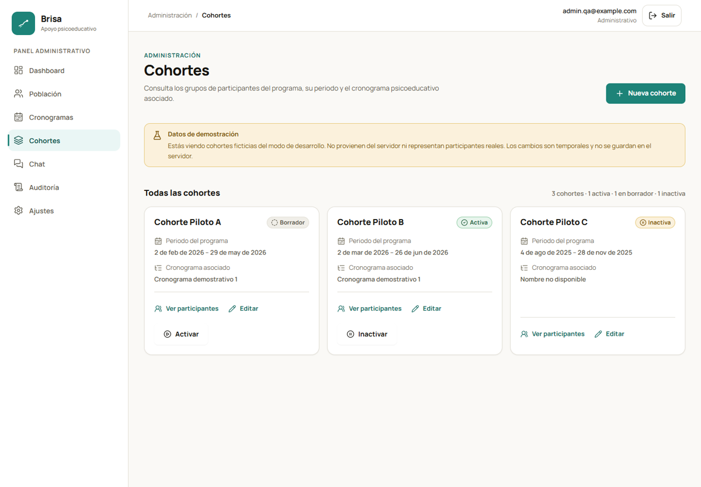
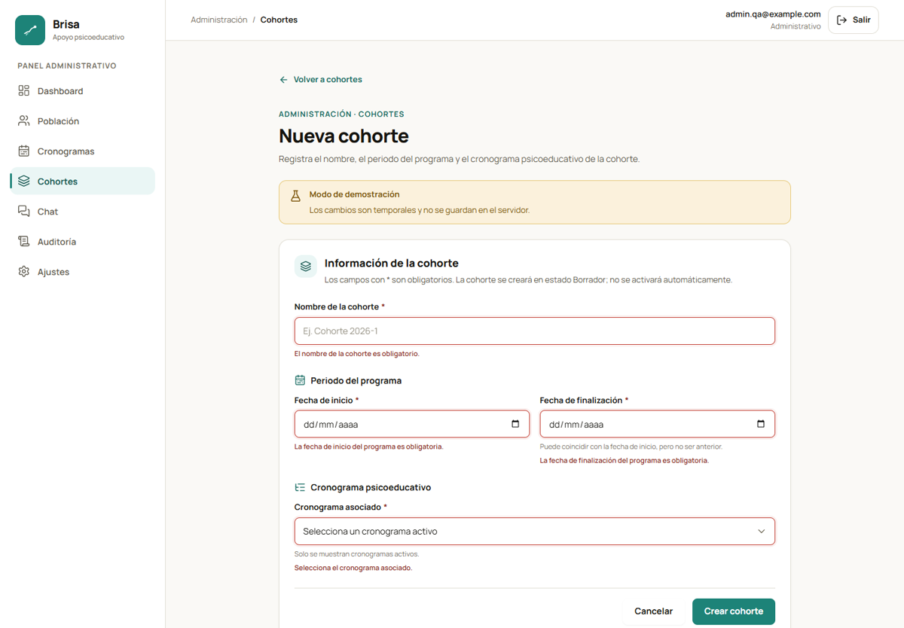
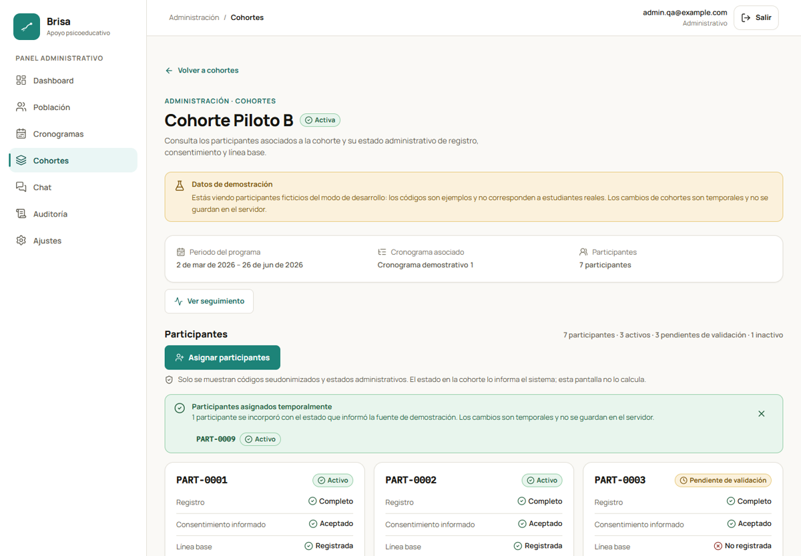
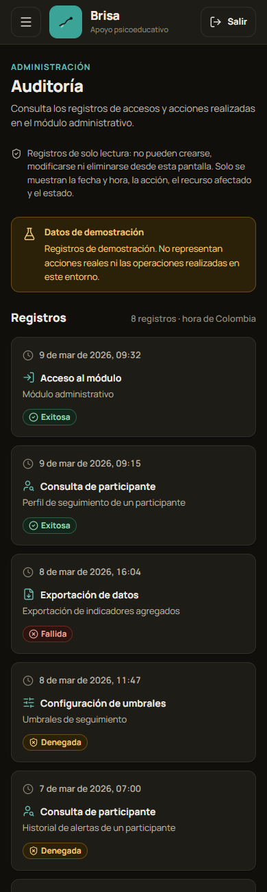
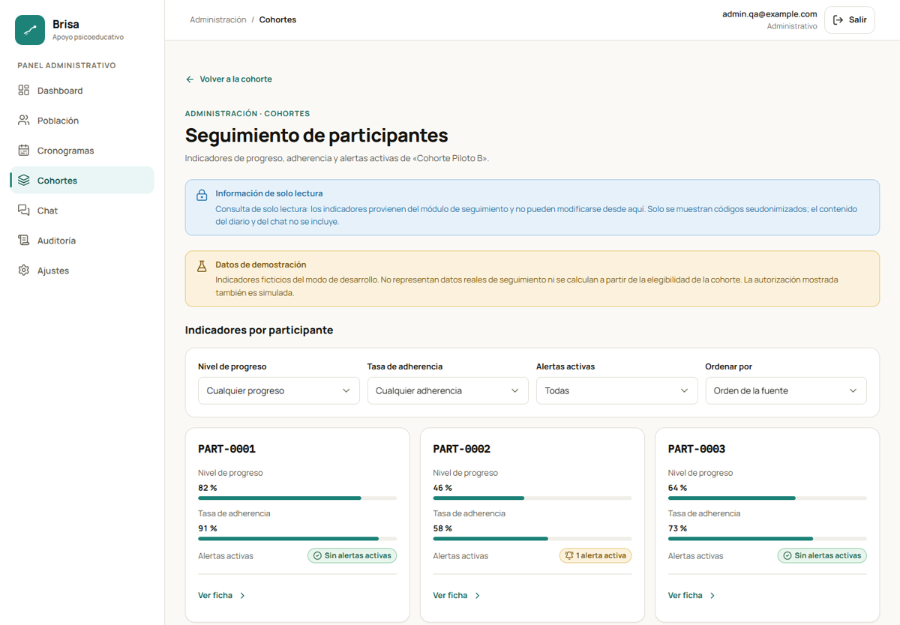
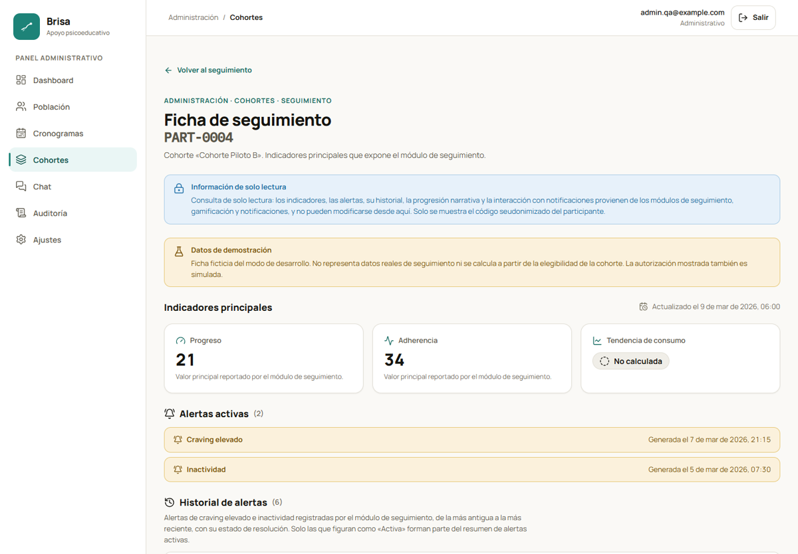
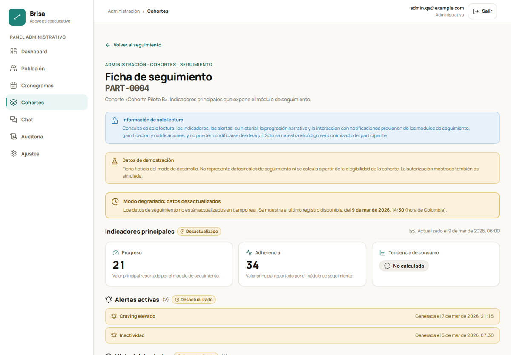

# BRISA — Informe integral de desarrollo del frontend administrativo (M08)

**Implementación de requerimientos, ampliaciones funcionales, arquitectura, validación y preparación para integración**

| Campo | Valor |
|---|---|
| Proyecto | BRISA — PWA de apoyo psicoeducativo para la cesación del consumo de vapeo en estudiantes universitarios (Universidad Surcolombiana, trabajo de grado) |
| Módulo | M08 — Administrativo (frontend) |
| Repositorio | Brisa-Frontend |
| Rama | `feat/m08-etapa1-admin-frontend` |
| Punto de partida | `1a6b684` (Merge PR #64, `feat/ux-ui-brisa`), 6 de noviembre de 2026 |
| Último commit revisado | `f4038bf` (E9-D5), 14 de noviembre de 2026 |
| Versión del documento | 1.0 (cierre de E10) |
| Fecha de elaboración | 15 de noviembre de 2026 |
| Estado | Frontend en modo demostración; integración con backend pendiente |

## 1. Resumen ejecutivo

Este documento registra el desarrollo del frontend administrativo del módulo M08 de BRISA realizado en la rama `feat/m08-etapa1-admin-frontend`, desde su creación a partir de `1a6b684` hasta la revisión integral de cierre (E10).

**Objetivo original.** La Etapa 1 del módulo administrativo asignó cuatro tareas: la bitácora de auditoría (RF-123), la gestión de cohortes (RF-124), la gestión de participantes de una cohorte (RF-125) y la restricción de solo lectura sobre datos de participantes (RF-148). En el frontend, estas tareas se tradujeron en pantallas de gestión y consulta, reglas de validación y mecanismos preventivos.

**Ampliación del alcance.** Una vez cubiertas las cuatro tareas, se decidió construir las interfaces mediante las cuales el administrador consulta la información de seguimiento de los participantes: el listado de seguimiento por cohorte (RF-142), la ficha individual (RF-128), el historial de alertas (RF-129), la progresión narrativa (RF-130), la interacción con notificaciones (RF-131), una consulta temporal del módulo de cronograma (M04, apoyada en RF-22 y RF-22B) y el modo degradado (RF-149).

**Alcance final alcanzado.**

- Seis pantallas administrativas nuevas: listado, creación/edición y detalle de cohortes; bitácora de auditoría; listado de seguimiento; y ficha individual con cinco secciones de consulta.
- Una feature completa `src/features/administracion/` (158 archivos de código y 72 de pruebas al cierre de E10) que sigue la arquitectura Feature-Based + Screaming Architecture del proyecto.
- Fuentes de datos intercambiables: hoy funcionan con datos ficticios en memoria, activados solo en desarrollo con `VITE_M08_DEMO=true`; sin esa variable las pantallas muestran «Integración pendiente».
- Validación por niveles: pruebas automatizadas (suite completa en verde), ESLint sin errores en el M08, build de producción sin datos ficticios, recorridos automatizados en Chrome y pruebas manuales aprobadas por el responsable en cada entrega.

**Lo que no está hecho.** No existe integración HTTP con el backend. Ningún endpoint del M08 existía al iniciar la rama, y la autorización real, la auditoría real, la protección de escritura en el servidor, la resiliencia ante caídas y la persistencia de los datos dependen del backend. El frontend está preparado para sustituir sus fuentes de demostración por adaptadores reales sin cambiar las páginas, pero **no está listo para producción**.

## 2. Contexto del proyecto

BRISA es una aplicación web progresiva (PWA) *mobile-first* de apoyo psicoeducativo para la cesación del consumo de vapeo en estudiantes universitarios, desarrollada como trabajo de grado en la Universidad Surcolombiana. Este repositorio contiene solo el frontend (React 19, Vite 8, Tailwind CSS 4, react-router v7).

La especificación de requerimientos organiza el sistema en módulos:

| Módulo | Nombre en la especificación |
|---|---|
| M01 | Gestión de usuario |
| M02 | Diario |
| M03 | Chat |
| M04 | Cronograma |
| M05 | Seguimiento |
| M06 | Gamificación y storytelling |
| M07 | Notificaciones |
| M08 | Administrativo |

**Función del M08.** Según la especificación, el M08 es el módulo del equipo de psicología. Restringe el acceso a usuarios administrativos autorizados (RF-122), registra en una bitácora los accesos y acciones (RF-123), gestiona cohortes y sus participantes (RF-124, RF-125) y permite consultar, en modo de solo lectura, la información que generan los participantes en los demás módulos (RF-128 a RF-131, RF-142). RF-148 exige que el M08 opere exclusivamente en solo lectura sobre los datos de M02, M03, M05, M06 y M07; las únicas escrituras permitidas son la configuración del programa, la gestión de cohortes y la bitácora. RF-149 exige que el M08 siga funcionando en modo degradado cuando los módulos fuente no estén disponibles.

**Relación con los demás módulos.** El M08 no calcula indicadores, no genera alertas ni modifica el avance de los participantes: consume lo que exponen M05 (perfil de seguimiento, RF-77), M06 (progresión narrativa, RF-116), M07 (métricas de interacción, RF-98) y M04 (ubicación temporal, RF-22 y RF-22B), y se apoya en M01 para la autenticación y los roles (RF-02, RF-03, RF-04).

## 3. Fuentes, método y evidencias

### 3.1 Fuentes consultadas

- `CLAUDE.md`: reglas de arquitectura, convenciones de código y design system del repositorio.
- `Especificacion Requerimientos (2).xlsx`, hoja «MO8- Administartivo» (RF-122 a RF-151) y requisitos relacionados de M01, M04, M05, M06 y M07. El archivo está en la raíz del repositorio y excluido del control de versiones mediante `.gitignore`.
- `Tareas etapa 1 modulo administrativo.md`: historias de usuario, criterios y contratos propuestos para RF-123, RF-124, RF-125 y la restricción de solo lectura. **El archivo ya no se encuentra en la ubicación donde se consultó durante el desarrollo (carpeta de descargas del equipo).** Para este informe se usó la copia íntegra que quedó registrada en el historial de trabajo de E8-A; se recomienda incorporarlo a `docs/` si debe conservarse.
- Historial real de Git de la rama (`git log`, `git show --stat`).
- Informes de entrega de cada etapa (E0 a E9-D5) registrados en el historial de trabajo, contrastados con el código actual.
- Código fuente actual de `src/features/administracion/`, `src/app/router/` y `src/app/layouts/AdminLayout/`.

### 3.2 Criterio de verificación

Ninguna funcionalidad se atribuye a la rama solo porque aparezca en un informe: cada una se comprobó en el código actual y, cuando aplica, en las pruebas automatizadas y en el recorrido de Chrome de E10. La rama parte de `1a6b684`, en el que no existía la carpeta `src/features/administracion/`; todo su contenido es trabajo de esta rama. Fuera de la feature, la rama solo modificó el router, la navegación administrativa, sus pruebas y `.gitignore` (sección 7.6).

**Resultados que se citan.** Los resultados de etapas anteriores provienen de los informes de cada entrega y se indican como tales. Los de E10 se obtuvieron durante esta revisión. Las pruebas manuales fueron realizadas por el responsable del proyecto; este documento recoge su aprobación declarada al iniciar cada etapa siguiente, no su detalle.

## 4. Alcance original: tareas de la Etapa 1

La Etapa 1 («Núcleo seguro») asignó cuatro tareas. Para cada una, la especificación y el archivo de tareas reparten la responsabilidad entre backend y frontend; este proyecto abarcó únicamente el frontend.

### 4.1 RF-123 — Bitácora de auditoría

- **Historia de usuario (archivo de tareas):** «Como equipo de psicología, quiero que cada acceso y acción quede registrado, para tener trazabilidad».
- **Criterios:** cada acción guarda usuario, sesión, acción, recurso, IP, marca temporal y estado (`EXITOSA`, `FALLIDA`, `DENEGADA`); UPDATE y DELETE sobre la bitácora fallan; si el registro falla en una consulta o exportación, se aborta la operación.
- **Técnico (backend):** `AuditoriaService.registrar` en modo síncrono (transacción de Prisma) o diferido (cola BullMQ con reintentos).
- **Vacío reconocido por el propio archivo de tareas:** RF-123 menciona una «consulta posterior», pero no define la vista.
- **Parte frontend:** una pantalla de consulta, de solo lectura, de los registros que entregue el backend.

### 4.2 RF-124 — Gestión de cohortes

- **Historia de usuario:** «Como equipo de psicología, quiero crear, editar, activar e inactivar cohortes, para segmentar el programa».
- **Criterios:** crear exige nombre, fechas con fin ≥ inicio y cronograma ACTIVO (si no, 400, 404 o 422); activar una cohorte BORRADOR devuelve 200 y se audita; una transición no permitida devuelve 409.
- **Contrato propuesto:** `POST /admin/cohortes` y `PATCH /admin/cohortes/:id_cohorte` con `{ id_cohorte, nombre_cohorte, fecha_inicio_programa, fecha_fin_programa, id_cronograma, estado: 'BORRADOR'|'ACTIVA'|'INACTIVA', fecha_actualizacion }`.

### 4.3 RF-125 — Participantes de una cohorte

- **Historia de usuario:** «Como equipo de psicología, quiero asignar y retirar participantes validando sus requisitos, para operar solo con quienes pueden iniciar».
- **Criterios:** un participante con registro completo, consentimiento aceptado y línea base queda ACTIVO; si no, `PENDIENTE_VALIDACION` con sus motivos. Ya asignado o en otra cohorte activa: 409. El listado muestra `codigo_participante`, **nunca el correo**.
- **Contrato propuesto:** `POST /admin/cohortes/:id/participantes { codigos_participante }` y el recurso `ParticipanteCohorte { codigo_participante, estado, estado_registro, estado_consentimiento, estado_linea_base, motivos_pendiente }`.

### 4.4 RF-148 — Restricción de solo lectura sobre datos de participantes

- **Historia de usuario:** «Como equipo de psicología, quiero que el administrador no pueda alterar datos de participantes, para preservar la integridad clínica».
- **Criterios:** con token ADMINISTRATIVO, POST, PUT, PATCH y DELETE sobre recursos de M02, M03, M05, M06 y M07 devuelven 403 sin tocar la base de datos; el intento queda en la bitácora (`INTENTO_ESCRITURA_BLOQUEADO`); GET funciona con normalidad.
- **Contrato:** `ErrorApi` con `status: 403` y `codigo: 'ESCRITURA_NO_PERMITIDA'`.
- **RF-148 aclara** que no basta con ocultar los botones de edición: la garantía es del servidor. Al frontend le corresponde no ofrecer escrituras sobre esos datos, consultarlos solo con GET y mostrar el rechazo de forma uniforme.

## 5. Ampliación del alcance

Tras completar las cuatro tareas (E9-B), se constató que el frontend no tenía ninguna interfaz para que el administrador consultara la información de los participantes en M02, M03, M05, M06 y M07; las únicas consultas existentes eran las del módulo de cronograma, que muestran el correo del participante y su identificador interno en la URL. El análisis E9-C propuso, y el responsable aprobó, una ampliación del frontend del M08 basada en requerimientos de la propia hoja M08 que no formaban parte de la asignación inicial.

| Ampliación | Requerimiento | Entrega |
|---|---|---|
| Listado de seguimiento de participantes por cohorte | RF-142 | E9-D1 |
| Ficha individual de seguimiento | RF-128 | E9-D2 |
| Historial de alertas | RF-129 | E9-D3 |
| Progresión narrativa | RF-130 | E9-D4 |
| Interacción con notificaciones | RF-131 | E9-D4 |
| Consulta temporal del cronograma | M04: RF-22 y RF-22B (sin requerimiento propio del M08) | E9-D5 |
| Modo degradado | RF-149 | E9-D5 |

**Decisiones de alcance tomadas en E9-C** (aprobadas por el responsable):

- Una sola ficha por participante, con una sección por módulo, a la que se entra desde el listado de la cohorte. No se añadió ninguna entrada nueva al menú: el recorrido es Cohortes → detalle → «Ver seguimiento» → «Ver ficha».
- El participante se identifica por su código seudonimizado y, en la URL, por una referencia opaca; nunca por correo ni UUID.
- El texto del diario (M02) y del chat (M03) no se muestra nunca. RF-142 lo excluye del listado; no se construyó ninguna consulta de esos módulos.
- La sección de M04 es propia del M08 y no reutiliza las páginas de cronograma, porque estas muestran el correo y el UUID.
- Quedan fuera la exportación de indicadores (RF-145) y la gestión de alertas (RF-147).

**Fuera del alcance de toda la rama:** RF-122 (control de acceso, que ya cubrían `RequireAuth` y `AdminLayout`), RF-126 (pausas desde el M08), RF-127 (modalidad terapéutica), RF-132 a RF-141 (vistas agregadas, configuración y panel consolidado), RF-143 y RF-144 (comparación y exportación agregada), RF-145, RF-147, RF-150 y RF-151.

## 6. Desarrollo por etapas

Cada entrega se planteó con un alcance cerrado, se verificó con pruebas automatizadas, build, ESLint y un recorrido en Chrome, y se detuvo hasta la prueba manual y la aprobación del responsable, que hizo personalmente los commits. Las etapas de análisis (E0, E8-A, E9-A, E9-C y E9-D2.0) no modificaron código.

### 6.1 Resumen cronológico

| Etapa | Objetivo | Requerimiento | Commit | Pruebas tras la etapa* |
|---|---|---|---|---|
| E0 | Análisis técnico inicial; sin cambios | RF-122 a RF-125 | — | 806 (línea base) |
| E1 | Estados y validación de cohortes | RF-124 | `84ef1c8` (2026-11-06) | 826 |
| E2 | Listado de cohortes con datos de prueba aislados | RF-124 | `557fcd1` (2026-11-07) | 889 |
| E3 | Creación y edición de cohortes | RF-124 | `a2bf1f5` (2026-11-07) | 972 |
| E4 | Activación e inactivación de cohortes | RF-124 | `000f4bd` (2026-11-07) | 1027 |
| E5 | Consulta de participantes por cohorte | RF-125 | `85646f6` (2026-11-07) | 1096 |
| E6 | Asignación de participantes | RF-125 | `f3c7f76` (2026-11-07) | 1167 |
| E7 | Retiro de participantes | RF-125 | `be21af3` (2026-11-07) | 1206 |
| E7-R1 | Corrección del catálogo: reasignación tras retiro | RF-125 | `be21af3` (incluida con E7) | 1217 |
| E8-A | Análisis del alcance frontend de la bitácora | RF-123 | — | — |
| E8-B | Consulta de la bitácora de auditoría | RF-123 | `db41920` (2026-11-07) | 1292 |
| E9-A | Análisis de la restricción de solo lectura | RF-148 | — | — |
| E9-B | Preparación frontend de la restricción | RF-148 | `f603e06` (2026-11-14) | 1324 |
| E9-C | Análisis de las interfaces de consulta | RF-128 a RF-131, RF-142, RF-149 | — | — |
| E9-D1 | Listado de seguimiento | RF-142 | `9a431e0` (2026-11-14) | 1407 |
| E9-D2.0 | Diagnóstico de la ficha individual | RF-128 | — | — |
| E9-D2 | Ficha individual de seguimiento | RF-128 | `f53d3ea` (2026-11-14) | 1515 |
| E9-D3 | Historial de alertas | RF-129 | `9f2eff1` (2026-11-14) | 1638 |
| E9-D4 | Progresión narrativa e interacción con notificaciones | RF-130, RF-131 | `32bab75` (2026-11-14) | 1782 |
| E9-D5 | Consulta temporal M04 y modo degradado | M04, RF-149 | `f4038bf` (2026-11-14) | 1908 |
| E10 | Revisión integral, correcciones y documentación | Todos | Commit a cargo del responsable tras su aprobación | 1915 |

\* Suite completa de Vitest según el informe de cada entrega. La de E10 se obtuvo en esta revisión.

**Relación entre etapas y commits.** Los mensajes de commit y los archivos que contiene cada uno coinciden con las entregas descritas. E7-R1 no tiene commit propio: sus cambios (`participantDemoStore.js` y sus pruebas) se incluyeron en `be21af3`, cuyo mensaje menciona «retiro y reasignación». Las etapas de análisis no generaron commits.

### 6.2 Detalle de cada etapa

#### E1 — Estados y validación de cohortes (RF-124)

- **Implementado:** `types/cohortStatus.js` (`BORRADOR`, `ACTIVA`, `INACTIVA`) y `services/cohortValidation.js` con `validateCohortForm`: nombre obligatorio (no vale solo con espacios), fechas obligatorias y reales en formato `YYYY-MM-DD`, y fin igual o posterior al inicio, con el mensaje literal de RF-124. Las fechas se comparan como días de calendario mediante `parseDateOnly` de `shared/utils/dateUtils.js`, sin desfase por zona horaria.
- **Sin pantallas ni datos de demostración.** 20 pruebas nuevas.

#### E2 — Listado de cohortes (RF-124)

- **Implementado:** la página `CohortListPage` en `/app/administrativo/cohortes`, la entrada «Cohortes» del menú administrativo (icono `Layers`), los componentes `CohortCard`, `CohortStatusBadge` y `CohortNotice`, y el patrón de fuente de datos que se usa en toda la rama: página → hook → fachada `cohortSource.js` → fuente de demostración cargada con `import()` dinámico solo si `import.meta.env.DEV && import.meta.env.VITE_M08_DEMO === 'true'`.
- **Estados:** carga, vacío, error con «Reintentar», integración pendiente y aviso de datos de demostración.
- **Cambios autorizados fuera de la feature:** la ruta en `AppRouter.jsx` y la entrada en `adminNavigation.js`, con sus pruebas.

#### E3 — Creación y edición (RF-124)

- **Implementado:** `CohortFormPage` (rutas `/cohortes/nueva` y `/cohortes/:idCohorte/editar`), `CohortForm` sobre `TextField` y `SelectField` de `shared/`, el catálogo ficticio de cronogramas y el almacén en memoria `cohortDemoStore.js`.
- **Reglas:** el cronograma es obligatorio y debe estar activo; la cohorte nace en `BORRADOR`; si el cronograma de una cohorte ya no está activo, la edición lo avisa y exige elegir otro; cancelar no guarda nada; un doble envío solo guarda una vez; ningún texto dice «guardada», porque nada se persiste en el servidor.
- **Accesibilidad:** cada error aparece junto a su campo (`aria-invalid`, `aria-describedby`, `role="alert"`) y el foco va al primer campo con error.

#### E4 — Activación e inactivación (RF-124)

- **Implementado:** `services/cohortTransitions.js` con las dos transiciones que confirma RF-124: BORRADOR → ACTIVA (revalidando nombre, fechas y cronograma activo en el momento de activar) y ACTIVA → INACTIVA (con confirmación en `ConfirmationDialog` de `shared/`). Las demás transiciones se rechazan y quedan como pendientes de contrato.
- **Protección ante acciones repetidas** en el hook y en el almacén. El aviso de resultado recibe el foco (`role="status"` o `role="alert"`).

#### E5 — Consulta de participantes por cohorte (RF-125)

- **Implementado:** `CohortDetailPage` en `/cohortes/:idCohorte`, con resumen (periodo, cronograma, número de participantes) y tarjetas de participante con su código seudonimizado y los estados de participación, registro, consentimiento y línea base, más los motivos de pendiente.
- **Decisiones:** los valores de estado se toman literalmente de RF-125 y no se traducen a los de M01; la interfaz no calcula la elegibilidad (un participante pendiente con todo completo se sigue mostrando como pendiente); un error de participantes nunca se presenta como lista vacía; la tarjeta solo pinta campos autorizados (una prueba le pasa correo, nombre, documento, consumo y perfil clínico, y ninguno aparece).

#### E6 — Asignación de participantes (RF-125)

- **Implementado:** el panel «Asignar participantes» dentro del detalle, con selección múltiple por código, participantes no disponibles con su motivo, confirmación «Confirmar asignación (N)», resultado enfocable con el estado que informa la fuente, y cancelación con botón o Escape.
- **Reglas de la fuente de demostración:** ya asignado, en otra cohorte activa, no disponible e inexistente; la asignación múltiple se definió como atómica y provisional (si un participante tiene conflicto, no se asigna ninguno y se listan los motivos). Tras un conflicto se vuelve a consultar el catálogo.

#### E7 y E7-R1 — Retiro y reasignación (RF-125)

- **E7:** acción «Retirar» en cada tarjeta, con `ConfirmationDialog` que explica que no se elimina al participante del sistema ni cambian sus estados; la fuente revalida cohorte, participante y asociación antes de aplicar el retiro, y ante datos desactualizados la página vuelve a consultar la lista en lugar de modificarla a ciegas.
- **E7-R1 (corrección):** los participantes iniciales (`PART-0001` a `PART-0008`) retirados no volvían al catálogo porque solo existían como asociaciones. Se construyó un registro único de participantes en el mismo almacén, de modo que un participante retirado vuelve a estar disponible y se reasigna con su mismo código, estados y motivos, sin condiciones para códigos concretos y sin duplicar asociaciones.

#### E8-A y E8-B — Bitácora de auditoría (RF-123)

- **E8-A (análisis):** delimitó que casi todo RF-123 es del backend (registro, inmutabilidad, IP, transacciones, cola y reintentos) y que el frontend nunca debe enviar eventos de auditoría, porque un registro generado en el navegador sería falsificable.
- **E8-B:** `AuditLogPage` en `/app/administrativo/auditoria`, entrada «Auditoría» en el menú (icono `ScrollText`), lista de registros en el orden de la fuente con fecha y hora en hora de Colombia, acción, recurso y estado con texto e icono. `services/auditEntry.js` descarta siempre la IP, el usuario, la sesión, el identificador del recurso y cualquier dato personal o clínico. El acceso denegado se detecta solo por el código `ACCESO_DENEGADO`, nunca por el texto. Fuente y escenarios propios, separados de cohortes.

#### E9-A y E9-B — Restricción de solo lectura (RF-148)

- **E9-A (análisis):** inventarió las pantallas existentes y comprobó que ninguna vista administrativa ofrecía escrituras sobre datos de M02, M03, M05, M06 o M07.
- **E9-B:** `types/readOnlyRestriction.js`, `services/readOnlyRestriction.js` con `isReadOnlyRejection(error)` (exige a la vez estado 403 verificable y código `ESCRITURA_NO_PERMITIDA`, priorizando el cuerpo del servidor sobre el `code` de axios), el aviso `ReadOnlyNotice` y la prueba de regresión `readOnlyRestriction.guard.test.jsx`, que lee el código real de la feature.

#### E9-C — Análisis de las interfaces de consulta

Revisó los requisitos de consulta individual de M02 a M07, identificó contradicciones entre documentos y propuso la ficha única por participante. Sus decisiones se resumen en la sección 5.

#### E9-D1 — Listado de seguimiento (RF-142)

- **Implementado:** `ParticipantTrackingPage` en `/cohortes/:idCohorte/seguimiento`, enlazada desde el detalle con «Ver seguimiento». Muestra por participante el código, el nivel de progreso y la tasa de adherencia (porcentaje con barra) y las alertas activas.
- **Filtros, orden y paginación** (por `offset` y `limit`, 5 por página provisionalmente) los aplica la fuente, no la interfaz; el hook normaliza los parámetros y descarta valores desconocidos.
- **Autorización explícita:** solo se muestran registros si la respuesta declara `access: 'AUTORIZADO'`; una respuesta de otra cohorte se bloquea entera y un registro ajeno se oculta con aviso.

#### E9-D2.0 y E9-D2 — Ficha individual (RF-128)

- **Implementado:** `ParticipantTrackingProfilePage` en `/cohortes/:idCohorte/seguimiento/:referencia`, con código, cohorte, progreso, adherencia, tendencia de consumo, alertas activas y fecha de actualización. El foco va al título al abrirla.
- **Decisiones:** los indicadores se muestran tal como llegan, sin unidad ni conversión; la tendencia se presenta en tono neutro; los estados 204, 403, 404, 409, 500 y 503 de RF-128 tienen su propio resultado; «fuera de la cohorte» es un estado propio. Listado y ficha comparten los datos ficticios para que no puedan contradecirse.

#### E9-D3 — Historial de alertas (RF-129)

Sección «Historial de alertas» en la ficha: tipo, estado (Activa, En revisión, Resuelta, Descartada), fecha de generación, fecha de resolución cuando aplica y fuente (RF-63 o RF-68), en orden ascendente. Autorización propia, bloqueo completo si alguna alerta no corresponde al participante, aviso si el resumen de alertas activas y el historial no coinciden. Desde esta entrega, la ficha se monta de nuevo al cambiar de participante en la URL.

#### E9-D4 — Progresión narrativa e interacción con notificaciones (RF-130, RF-131)

Dos secciones nuevas con autorización y errores propios mediante un hook común (`useProfileSectionQuery`) y un intérprete común (`profileSectionResponse.js`). M06: fase activa, último capítulo (solo si llega su nombre) y logros. M07: cinco totales y tres tasas, distinguiendo cero real, `NO_CALCULABLE` y dato ausente.

#### E9-D5 — Consulta temporal M04 y modo degradado (RF-149)

Sección «Ubicación temporal en el programa» (unidad vigente, tiempo efectivo transcurrido, estado del cronograma y pausas) y modo degradado en todas las secciones: interpretación de la marca de desactualización que envíe el backend, aviso no ocultable con la fecha exacta, bloqueo de datos sin fecha confiable, independencia de las secciones y un límite de error por sección.

#### E10 — Revisión integral y documentación

Revisión del código, de la arquitectura, de la privacidad y de la interfaz; regresión automatizada y en Chrome; seis defectos corregidos (sección 11.4) y este documento.

## 7. Arquitectura técnica

### 7.1 Principios

El repositorio sigue **Feature-Based + Screaming Architecture** (`CLAUDE.md`): la estructura refleja el dominio. Todo el M08 vive en `src/features/administracion/`, sin importar de otras features; lo compartido viene únicamente de `@/shared/` (`Button`, `Checkbox`, `ConfirmationDialog`, `SelectField`, `TextField` y `dateUtils`) y de las librerías permitidas (`react`, `react-router-dom`, `lucide-react`). Una prueba de regresión (`readOnlyRestriction.guard.test.jsx`) vigila estas importaciones en el código real.

### 7.2 Capas y responsabilidades

| Capa | Contenido en el M08 | Responsabilidad |
|---|---|---|
| `pages/` | 6 páginas con sus `hooks/` | La página compone y pinta; el estado vive en `hooks/use<Page>.js` |
| `components/` | 28 componentes | Presentación: tarjetas, insignias de estado, secciones de la ficha, avisos, controles de filtros y paginación |
| `services/` | 18 módulos puros | Validaciones, transiciones, interpretación de respuestas (autorización, aislamiento, listas de campos permitidos), frescura de los datos |
| `data/` | Fachadas, fuentes y datos de demostración | Fachadas estables (`*Source.js`) que hoy cargan la demostración y mañana delegarán en adaptadores HTTP |
| `types/` | Catálogos congelados (`Object.freeze`) | Estados, códigos de error, resultados y enumerados de los requerimientos |
| `utils/` | Formato de fechas, rutas, mensajes y escenarios de demostración | Ayudantes de la feature |

**Sobre la carpeta `api/`.** `CLAUDE.md` reserva `api/` para la comunicación con el backend. Como no se autorizó ninguna integración, el M08 no tiene `api/` ni ninguna llamada HTTP; las fachadas de `data/` son el punto donde se conectarán los futuros adaptadores de `api/`. La prueba de regresión de RF-148 establece que las escrituras HTTP solo podrán vivir en `administracion/api/` y nunca contra recursos de M02, M03, M05, M06 o M07.

### 7.3 Flujo de una consulta

```text
Página (pages/*Page.jsx)                solo compone y pinta
  │  key = parámetros de la ruta          se monta de nuevo al cambiar de cohorte o participante
  ▼
Hook (pages/*/hooks/use*.js)            estado, carga, reintento, foco
  │  recibe `source` por parámetro        sustituible en pruebas e integración
  ▼
Fachada (data/*Source.js)               firma estable: getX(cohortId, referencia)
  │  getMode(): DEMO | PENDING_INTEGRATION
  ├─ DEV && VITE_M08_DEMO === 'true' ──► import() dinámico de data/*DemoSource.js
  │                                        (escenarios, esperas simuladas, almacén en memoria)
  └─ en otro caso ───────────────────► rechazo «no está integrada» (hoy)
                                          adaptador de api/ (futuro)
  ▼
Servicio puro (services/*Response.js)   interpreta la respuesta:
     1. autorización explícita (access === 'AUTORIZADO')
     2. aislamiento: cohorte y referencia pedidas
     3. lista explícita de campos permitidos
     4. frescura (RF-149), solo después de 1-3
  ▼
Resultado estructurado (OK, EMPTY, DENIED, INCONSISTENT, …) → estado de la sección
```

### 7.4 Estructura de la ficha individual

```text
ParticipantTrackingProfilePage  (key = cohorte|referencia)
├─ useParticipantTrackingProfile ── M05 perfil (RF-128)
├─ allowsDependentSections(perfil) ── decide si se consultan las demás
├─ SectionErrorBoundary ► AlertHistorySection           ── useAlertHistory (RF-129)
├─ SectionErrorBoundary ► NarrativeProgressSection      ── useNarrativeProgress (RF-130, M06)
├─ SectionErrorBoundary ► NotificationInteractionSection ── useNotificationInteraction (RF-131, M07)
└─ SectionErrorBoundary ► TemporalLocationSection        ── useTemporalLocation (M04)
```

Las secciones dependientes se consultan cuando el perfil está listo, sin perfil (204), no disponible, con error o desactualizado sin fecha; no se consultan mientras carga ni cuando la ficha fue denegada, el participante o la cohorte no existen, el participante está fuera de la cohorte o la respuesta es inconsistente.

### 7.5 Rutas y navegación

| Ruta | Página | Requerimiento |
|---|---|---|
| `/app/administrativo/cohortes` | Listado de cohortes | RF-124 |
| `/app/administrativo/cohortes/nueva` | Crear cohorte | RF-124 |
| `/app/administrativo/cohortes/:idCohorte/editar` | Editar cohorte | RF-124 |
| `/app/administrativo/cohortes/:idCohorte` | Detalle y participantes | RF-125 |
| `/app/administrativo/cohortes/:idCohorte/seguimiento` | Listado de seguimiento | RF-142 |
| `/app/administrativo/cohortes/:idCohorte/seguimiento/:referencia` | Ficha individual | RF-128 a RF-131, M04, RF-149 |
| `/app/administrativo/auditoria` | Bitácora | RF-123 |

Todas están dentro de la cadena existente `RequireAuth → ProtectedLayout → RequireAuth(ADMINISTRATIVO) → AdminLayout`; un estudiante es redirigido a `/app/estudiante` y un visitante sin sesión a `/login`. El menú añade «Cohortes» y «Auditoría»; las rutas de seguimiento mantienen activa la sección Cohortes.

### 7.6 Cambios fuera de la feature

| Archivo | Cambio | Etapas |
|---|---|---|
| `src/app/router/AppRouter.jsx` | Siete rutas del M08 dentro de las guardas existentes | E2, E3, E5, E8-B, E9-D1, E9-D2 |
| `src/app/router/AppRouter.test.jsx` | Pruebas de las rutas, sus guardas y la sección activa | Las mismas |
| `src/app/layouts/AdminLayout/adminNavigation.js` | Entradas «Cohortes» y «Auditoría» y su detección como sección activa; identificadores locales, sin tocar `shared/` | E2, E8-B |
| `adminNavigation.test.js`, `noDuplicateNavigation.test.js` | Pruebas de la navegación; la segunda vigila también las páginas del M08 | E2, E3, E5, E8-B |
| `.gitignore` | Exclusión de `Especificacion Requerimientos (2).xlsx` | Commit `db41920` |

No se modificaron `shared/`, `AdminLayout.jsx`, la autenticación, las otras features ni la configuración del proyecto.

## 8. Interfaces desarrolladas

Las capturas de esta sección se obtuvieron durante el recorrido de E10 en Chrome, con datos ficticios del modo demostración y una sesión administrativa ficticia; no contienen credenciales ni datos reales. El correo que aparece en el encabezado de `AdminLayout` es el de esa sesión de prueba.

### 8.1 Gestión de cohortes (RF-124)

El listado presenta cada cohorte como una tarjeta con nombre, estado (insignia con texto e icono), periodo del programa y cronograma asociado, con un resumen por estado. Desde cada tarjeta se accede a «Ver participantes», «Editar» y, según el estado, «Activar» o «Inactivar». El formulario de creación y edición valida nombre, fechas y cronograma activo y muestra cada error junto a su campo.





### 8.2 Detalle de cohorte y participantes (RF-125)

El detalle muestra el resumen de la cohorte, el enlace «Ver seguimiento» y las tarjetas de participantes con su código seudonimizado y sus estados administrativos. La asignación se hace en un panel dentro de la página y el retiro desde cada tarjeta, con confirmación.



### 8.3 Bitácora de auditoría (RF-123)

Lista de solo lectura, sin controles: fecha y hora en hora de Colombia, acción, recurso afectado y estado.



### 8.4 Listado de seguimiento (RF-142)

Indicadores por participante con filtros por progreso, adherencia y alertas, orden por cada indicador y paginación. Cada tarjeta enlaza con «Ver ficha».



### 8.5 Ficha individual de seguimiento (RF-128 a RF-131, M04, RF-149)

La ficha reúne, en este orden: los indicadores principales y las alertas activas (RF-128), el historial de alertas (RF-129), la progresión narrativa (RF-130), la interacción con notificaciones (RF-131) y la ubicación temporal (M04). Cada sección tiene título con icono, su propio estado y, si corresponde, la marca de desactualización.





## 9. Gestión de datos de demostración

### 9.1 Activación

Los datos ficticios solo se cargan si se cumplen a la vez dos condiciones: el servidor está en modo desarrollo (`import.meta.env.DEV`) y la variable `VITE_M08_DEMO` vale `true`. La condición se repite literalmente en cada fachada, y la fuente de demostración se carga con `import()` dinámico dentro de ella, de modo que el empaquetador la elimina del build de producción.

Sin esa condición, cada pantalla muestra «Integración pendiente» y no presenta datos, acciones de escritura ni filtros.

### 9.2 Escenarios

Cada consulta tiene su propia variable de escenario, independiente de las demás; un valor vacío o desconocido equivale al predeterminado. Cambiar una variable exige reiniciar `npm run dev`.

| Variable | Pantalla o sección | Valores |
|---|---|---|
| `VITE_M08_DEMO_SCENARIO` | Cohortes y participantes | `lista` (predeterminado), `vacio`, `carga`, `error`, `sin-cronogramas`, `error-guardado`, `activacion-bloqueada`, `error-participantes`, `carga-participantes`, `conflictos-asignacion`, `error-catalogo`, `retiro-desactualizado` |
| `VITE_M08_AUDIT_SCENARIO` | Bitácora | `lista`, `vacia`, `carga`, `error`, `denegada` |
| `VITE_M08_TRACKING_SCENARIO` | Listado de seguimiento | `lista`, `carga`, `error`, `denegado`, `registro-ajeno`, `respuesta-ajena` |
| `VITE_M08_PROFILE_SCENARIO` | Ficha (M05) | `perfil`, `carga`, `error`, `denegado`, `sin-perfil`, `inexistente`, `inconsistente`, `otra-cohorte`, `fuera-de-cohorte`, `no-disponible`, `desactualizado`, `desactualizado-sin-fecha` |
| `VITE_M08_ALERT_HISTORY_SCENARIO` | Historial (M05) | `historial`, `vacio`, `denegado`, `inexistente`, `otro-participante`, `otra-cohorte`, `no-disponible`, `error`, `carga`, `desfase`, `desactualizado`, `desactualizado-sin-fecha` |
| `VITE_M08_NARRATIVE_SCENARIO` | Progresión narrativa (M06) | `narrativa`, `carga`, `error`, `denegado`, `sin-permiso-explicito`, `sin-datos`, `sin-logros`, `inexistente`, `otro-participante`, `otra-cohorte`, `no-disponible`, `desactualizado`, `desactualizado-sin-fecha` |
| `VITE_M08_NOTIFICATIONS_SCENARIO` | Notificaciones (M07) | `notificaciones`, `carga`, `error`, `denegado`, `sin-datos`, `no-calculable`, `inexistente`, `otro-participante`, `otra-cohorte`, `no-disponible`, `desactualizado`, `desactualizado-sin-fecha` |
| `VITE_M08_TEMPORAL_SCENARIO` | Ubicación temporal (M04) | `cronograma`, `carga`, `error`, `denegado`, `sin-datos`, `inexistente`, `otro-participante`, `otra-cohorte`, `no-disponible` |

La descripción comentada de cada valor está en su módulo `utils/*DemoScenario.js`. La cohorte vacía y la inexistente del listado de seguimiento se obtienen con los datos (Piloto A y una cohorte que no existe), sin escenario.

### 9.3 Aislamiento de los datos ficticios

- **Ubicación:** solo en `data/*DemoData.js`, importados únicamente por las fuentes de demostración y por las pruebas.
- **Inmutabilidad:** los datos iniciales están congelados; los almacenes en memoria crean objetos nuevos en cada cambio.
- **Persistencia:** ninguna. Los cambios viven en memoria del módulo, se conservan al navegar y se pierden al recargar. No se usa `localStorage`, `sessionStorage` ni IndexedDB.
- **Valores ficticios reconocibles:** códigos `PART-NNNN`, referencias sintéticas `seg-xxxxxx`, nombres «ficticios», IP de rangos de documentación (RFC 5737) y correos de `example.com`. Las fuentes de demostración añaden a propósito campos prohibidos (UUID, correos, motivos de pausa, mensajes) para comprobar que la interfaz los descarta.
- **Separación de dominios:** los indicadores de seguimiento no se calculan a partir de la elegibilidad de RF-125, y la bitácora ficticia no menciona las operaciones de cohortes de la demostración.
- **Aviso visible:** cada pantalla en modo demostración muestra «Datos de demostración»; las denegaciones simuladas lo indican expresamente.

### 9.4 Exclusión del build de producción

En cada entrega, y de nuevo en E10, se generó el build y se buscaron en `dist/` los códigos, referencias, nombres, escenarios y textos propios de la demostración, sin coincidencias (sección 12.4). Solo llegan al build los textos genéricos de los avisos, que en producción no se muestran.

### 9.5 Sustitución durante la integración

Para integrar una consulta bastará con:

1. Crear el adaptador en `src/features/administracion/api/`, usando `apiClient` de `shared/`.
2. Hacer que la fachada correspondiente de `data/` devuelva, fuera del modo demostración, la respuesta del adaptador con la misma forma que hoy produce la demostración (incluida la traducción de un 204 sin cuerpo a un resultado estructurado y de los errores a códigos).
3. Ajustar `getMode()` para que deje de informar «integración pendiente».
4. Sustituir el invariante temporal de la prueba de RF-148 («ninguna llamada HTTP en el M08») por la lista de recursos permitidos.

Las páginas, los hooks y los servicios no deberían necesitar cambios si el contrato se respeta.

## 10. Seguridad, privacidad y restricciones

### 10.1 Controles implementados en el frontend

| Control | Implementación | Verificación |
|---|---|---|
| Acceso por rol | Rutas dentro de `RequireAuth(ADMINISTRATIVO)` existente | `AppRouter.test.jsx`; redirección del estudiante en Chrome |
| Seudonimización | Solo códigos `PART-NNNN`; nunca correo, nombre ni documento | Pruebas de privacidad en tarjetas, catálogo, listado y ficha; búsqueda en el DOM en Chrome |
| Referencias opacas | La URL de la ficha lleva una referencia sintética, nunca UUID ni correo | Pruebas de rutas y de la fuente |
| Listas de campos permitidos | Cada intérprete de `services/` conserva solo los campos autorizados | Las demostraciones envían campos prohibidos y las pruebas comprueban que se descartan |
| Autorización explícita por sección | Solo se muestran datos si la respuesta declara `access: 'AUTORIZADO'`; cualquier otro valor equivale a denegado | Escenarios `denegado` que envían datos y comprueban que no se muestran |
| Aislamiento | Se bloquea la respuesta que declara otra cohorte u otro participante | Escenarios `otro-participante`, `otra-cohorte`, `inconsistente`, `respuesta-ajena` |
| Pertenencia a la cohorte | Un participante retirado no da acceso con su antigua referencia | Pruebas de fuente y recorrido manual |
| Sin datos residuales | La ficha, el listado de seguimiento y el detalle se montan de nuevo al cambiar de participante o cohorte | `ParticipantTrackingProfileRemount.test.jsx`, `CohortRouteRemount.test.jsx`, Chrome |
| Diario y chat | No existe ninguna consulta de contenido de M02 ni M03 | Prueba de RF-148 sobre referencias a esos recursos |
| Notificaciones | No se muestran mensajes ni eventos de origen | Pruebas del intérprete de RF-131 |
| Errores por código | Ninguna decisión se toma comparando textos de error | Pruebas con mensajes engañosos sin código |
| Sin registros en consola | No hay `console.*` en el código del M08 | Revisión estática de E10 |
| Sin almacenamiento del navegador | No hay `localStorage`, `sessionStorage` ni IndexedDB en el M08 | Revisión estática de E10 |
| Sin datos ficticios en producción | Carga condicionada y dinámica | Búsqueda en `dist/` |
| Modo degradado seguro | La frescura se evalúa después de la autorización y el aislamiento; los datos sin fecha confiable no se muestran | `freshness.test.js`, `dataFreshness.test.js`, Chrome |

### 10.2 Restricción de solo lectura (RF-148)

- **Ninguna pantalla de consulta tiene controles de escritura.** El listado de seguimiento y la ficha solo tienen enlaces de navegación y, en los estados de error, botones «Reintentar». La bitácora no tiene ningún control.
- **Las escrituras del M08 son solo las autorizadas por RF-148:** gestión de cohortes (crear, editar, activar, inactivar) y de sus participantes (asignar, retirar), que es una operación de RF-124 y RF-125 sobre la asociación con la cohorte, no sobre datos de M02, M03, M05, M06 ni M07. Hoy esas escrituras solo afectan a la memoria de la demostración.
- **Rechazo uniforme preparado:** `isReadOnlyRejection` reconoce el 403 con `ESCRITURA_NO_PERMITIDA` y `getReadOnlyMessage` devuelve el mensaje uniforme «Esta información es de solo lectura para el rol administrativo». Todavía no está conectado a ninguna operación, porque ninguna pantalla escribe sobre recursos protegidos.
- **Aviso de solo lectura:** `ReadOnlyNotice` aparece en el listado de seguimiento y en la ficha.
- **Prueba de regresión:** `readOnlyRestriction.guard.test.jsx` falla si el M08 importa otras features, si cualquier archivo distinto de `utils/cohortRoutes.js` menciona recursos de M02, M03, M05, M06 o M07, si aparece una llamada HTTP o si las vistas de consulta ganan controles de edición.

### 10.3 Garantías que dependen del backend

El frontend reduce riesgos y presenta los resultados de forma segura, pero **no puede garantizar por sí solo** ninguno de estos puntos, que deberán verificarse durante la integración:

- autenticación, rol y permisos explícitos por consulta (RF-02, RF-03, RF-04, RF-122);
- rechazo real de escrituras sobre recursos protegidos, con base de datos intacta y registro `INTENTO_ESCRITURA_BLOQUEADO` (RF-148);
- generación, persistencia, inmutabilidad y confiabilidad de la bitácora, incluida la auditoría de cada consulta individual (RF-123); el frontend no genera ni simula registros;
- aislamiento por participante en la respuesta (409 de RF-128 a RF-131);
- seudonimización y referencias opacas generadas por el servidor;
- caché, marca de desactualización y resiliencia ante caídas (RF-149); la demostración no acredita resiliencia real;
- consentimiento vigente y proporcionalidad para datos sensibles (RF-52);
- validación real de elegibilidad, transiciones de estado y conflictos de asignación.

## 11. Revisión integral (E10)

### 11.1 Arquitectura y código

| Aspecto | Resultado |
|---|---|
| Ubicación | Todo en `src/features/administracion/`; fuera solo los cambios autorizados de la sección 7.6 |
| Importaciones entre features | Ninguna; solo `@/shared/` y librerías permitidas (vigilado por prueba) |
| Páginas delgadas | Las páginas componen; estado y lógica en hooks; reglas en servicios puros |
| Servicios independientes de React | Los 18 módulos de `services/` son funciones puras con pruebas propias |
| Errores estructurados | Por código (`ACCESO_DENEGADO`, `MODULO_NO_DISPONIBLE`, `ESCRITURA_NO_PERMITIDA`, …), nunca por texto |
| Fuentes separadas | Fachadas de cohortes, participantes, auditoría, seguimiento, M06/M07 y M04, con cargadores protegidos |
| HTTP | Ninguna llamada (`fetch`, axios, `apiClient`, XHR, beacon, WebSocket) |
| Convenciones | Nombres en inglés y textos en español; `index.js` por carpeta; `Object.freeze` en catálogos; tokens de diseño; iconos `lucide-react`; sin emoji |
| `console` y almacenamiento | Ninguna aparición en el código del M08 |
| `AdminLayout` y guardas | Sin modificar; rutas dentro de la cadena existente |

### 11.2 Interfaz y accesibilidad

- Identidad visual BRISA con tokens de `tokens.css`, tema claro y oscuro, y diseño de una columna desde 360 px que se amplía en pantallas grandes.
- Un único `h1` y un único `main` por pantalla; jerarquía `h2` por sección y `h3` por tarjeta.
- Estados de carga (`aria-busy` y anuncio para lectores de pantalla), vacíos, error con «Reintentar», denegado e integración pendiente en todas las pantallas.
- Los estados nunca dependen solo del color: insignias y avisos llevan texto e icono.
- Foco gestionado: primer campo con error en formularios, título del panel al asignar, aviso de resultado tras activar, inactivar, asignar o retirar, y título de la ficha al abrirla.
- Formularios con etiquetas, `aria-invalid`, `aria-describedby` y mensajes de error en texto.
- Las advertencias de modo degradado son `role="status"`, no se pueden cerrar y no añaden elementos enfocables.
- **Organización de la ficha:** las cinco secciones añadidas en E9-D2 a E9-D5 comparten patrón (título con icono, descripción breve, contenido en tarjetas o listas y estado propio) y siguen un orden coherente: seguimiento de M05, historial de M05, M06, M07 y M04. La revisión de las capturas no mostró solapamientos ni desbordes.

### 11.3 Defectos encontrados

| # | Defecto | Gravedad | Evidencia |
|---|---|---|---|
| D1 | 82 pruebas de las fuentes de demostración dependían de las variables de escenario del `.env.local` de quien las ejecutaba. Con el archivo dejado tras las pruebas manuales de E9-D5 (escenarios `desactualizado`), 4 pruebas fallaban; con otros valores fallaban hasta 82 | Media (calidad de pruebas; sin efecto en la aplicación) | Suite completa con el `.env.local` actual: 1904/1908; con escenarios no predeterminados: 82 fallos |
| D2 | Al cambiar de cohorte dentro de la misma ruta (URL o historial), el listado de seguimiento conservaba el orden, los filtros y la página de la cohorte anterior y mostraba un instante su encabezado; en Piloto C (2 participantes) la página 2 heredada dejaba la lista vacía | Media | Recorrido de Chrome de E10 (B → C) |
| D3 | En el mismo caso, el detalle de cohorte conservaba abierto el panel de asignación y podía conservar avisos de la cohorte anterior | Baja | Recorrido de Chrome de E10 (B → A) |
| D4 | El aviso de un retiro seguía visible junto al resultado de una asignación posterior, y viceversa; quedó registrado como pendiente en el informe de E7-R1 | Baja (experiencia de usuario) | Informe de E7-R1 y revisión del código |
| D5 | Falta de espacio entre dos atributos JSX en la ficha (`key={…}cohortId`) | Formato | Revisión del código |
| D6 | En el modo degradado simulado, la fecha del último dato disponible (8 de marzo, 14:30) era anterior a la fecha de actualización de los datos que acompañaba (9 de marzo, 06:00), lo que mostraba información contradictoria | Baja (coherencia de los datos de demostración) | Captura de Chrome de E10 |

### 11.4 Correcciones realizadas

| # | Corrección | Archivos | Pruebas |
|---|---|---|---|
| D1 | Ayudante de pruebas `resetDemoScenarios(vi)` que deja vacías las 8 variables de escenario antes de cada prueba de las fuentes; cada prueba fija después el escenario que necesita. No importa nada, para respetar la prueba de RF-148. No cambia ninguna aserción | `data/demoScenarioTestEnv.js` (nuevo) y el `beforeEach` de 9 archivos de prueba | `data/demoScenarioTestEnv.test.js` comprueba que el ayudante cubre todas las variables que leen los utilitarios. Verificado con la suite en tres entornos distintos |
| D2, D3 | El listado de seguimiento y el detalle de cohorte se montan de nuevo con una clave por cohorte, como la ficha desde E9-D3 | `ParticipantTrackingPage.jsx`, `CohortDetailPage.jsx` | `pages/CohortRouteRemount.test.jsx` y Chrome |
| D4 | Asignar descarta el aviso del retiro anterior y retirar descarta el resultado de la asignación anterior | `useParticipantRemoval.js` (`dismissNotice`), `CohortDetailPage.jsx` | Una prueba nueva en `useParticipantRemoval.test.js` y en `CohortParticipantAssignment.test.jsx`; ampliada una aserción de `CohortParticipantRemoval.test.jsx` |
| D5 | Espacio entre atributos | `ParticipantTrackingProfilePage.jsx` | — |
| D6 | La fecha simulada pasa al 9 de marzo de 2026, 14:30, posterior a todas las fechas de los datos de M05, M06 y M07 | `data/degradedDemo.js` | Prueba nueva en `temporalAndDegradedSource.test.js`, que falla con la fecha anterior; Chrome |

**Pruebas aprobadas modificadas en E10:** `CohortParticipantAssignment.test.jsx` verificaba que `onAssigned` era exactamente `addParticipants`. Con la corrección D4, `onAssigned` es una función que llama a `addParticipants` y descarta el aviso de retiro; la prueba pasa a llamarla y comprobar ambos efectos, y una prueba nueva lo documenta. Ninguna prueba se eliminó ni se desactivó.

### 11.5 Aspectos revisados que no se modificaron

- **Aviso del formulario tras activar:** después de editar una cohorte y activarla, el listado muestra a la vez «Cambios aplicados temporalmente» (procedente de la navegación desde el formulario) y «Cohorte activada temporalmente». Es el comportamiento aprobado en E3 y E4; se documenta como posible ajuste de presentación.
- **Formulario de cohorte entre rutas:** en teoría, pasar directamente de `/cohortes/A/editar` a `/cohortes/B/editar` reutiliza la instancia del formulario. La carga posterior reemplaza los valores y no hay forma de llegar a ese cambio desde la interfaz, así que no se modificó.
- **Paginación del listado de cohortes y de la bitácora:** no existe, porque ningún requerimiento la define; queda como contrato pendiente.
- **Altura de algunos botones compartidos** (`Button` de `shared/`, 42 px en lugar de 44 px en algunos casos): documentado desde E2; no se modifica `shared/` desde esta rama.
- **Errores globales de ESLint fuera del M08:** 7 errores preexistentes en otras features (sección 12.3); no se corrigen desde esta rama.

## 12. Pruebas y aseguramiento de calidad

### 12.1 Tipos de prueba

| Tipo | Herramienta y técnica | Qué cubre |
|---|---|---|
| Unitarias de servicios | Vitest en Node | Validaciones, transiciones, interpretación de respuestas, frescura, formatos |
| Datos y fuentes | Vitest con espía de `fetch` | Escenarios, almacenes, coherencia entre listado y ficha, ausencia de HTTP, inmutabilidad |
| Hooks | Vitest con un React mínimo simulado (`useState` por posición) | Estados, reintentos, protección ante dobles envíos, foco |
| Componentes y páginas | `renderToStaticMarkup` con `MemoryRouter` (ADR-0002: sin jsdom ni Testing Library) | Contenido, roles ARIA, estados, ausencia de controles de escritura y de datos privados |
| Rutas y navegación | `AppRouter.test.jsx`, `adminNavigation.test.js`, `noDuplicateNavigation.test.js` | Guardas por rol, sección activa, una sola navegación |
| Regresión de arquitectura | `readOnlyRestriction.guard.test.jsx` | Importaciones, recursos protegidos, HTTP, controles de escritura |
| Navegador | Chrome headless con sesión administrativa ficticia interceptada, en un perfil aislado | Recorridos completos, temas, anchos, consola, peticiones y privacidad del DOM |
| Manuales | Responsable del proyecto | Aprobación de cada entrega antes de la siguiente |

### 12.2 Resultados automatizados de E10

| Comprobación | Resultado |
|---|---|
| Suite completa de Vitest | **1915/1915** en 150 archivos |
| Pruebas de `administracion` y de `src/app` | 1313 |
| Suite de `administracion` y `src/app` con escenarios no predeterminados | 1313/1313 en dos combinaciones distintas |
| Suite completa antes de las correcciones | 1904/1908 (los 4 fallos de D1) |

### 12.3 Build y ESLint

| Comprobación | Resultado |
|---|---|
| `npm run build` | Correcto. Aviso preexistente de tamaño de bloque (> 500 kB), común a toda la aplicación |
| ESLint en `src/features/administracion`, `src/app/router` y `src/app/layouts/AdminLayout` | Sin errores ni avisos |
| ESLint global | 7 errores preexistentes fuera del M08, en 7 archivos de `features/cronograma` y `features/users` (`no-useless-catch`, `no-unused-vars` y una regla del compilador de React sobre `setState` en efectos), los mismos desde E0 |
| `git diff --check` | Sin problemas |

### 12.4 Datos ficticios en `dist/`

El build de producción de E10, generado después de todas las correcciones, se revisó buscando 25 marcadores propios de la demostración: códigos `PART-`, identificadores `demo-cohorte`, `demo-participante` y `demo-candidato`, referencias `seg-…`, nombres «Cohorte Piloto», «Cronograma demostrativo», «Fase ficticia», «Logro ficticio» y «Unidad ficticia», textos «Motivo ficticio» y «Mensaje ficticio», IP de documentación, `example.com`, nombres de escenarios, la fecha simulada del modo degradado, `demoResult`, `AJENO-0000` y el ayudante de pruebas. **Resultado: 0 coincidencias.**

### 12.5 Pruebas en Chrome de E10

Chrome headless con una sesión administrativa ficticia interceptada en un perfil aislado; cada fase en su propio servidor de desarrollo con los escenarios fijados explícitamente (sin depender del `.env.local`). Se ejecutaron 11 fases; cuatro tuvieron que repetirse porque Chrome no abrió su puerto de depuración a tiempo (incidencia del entorno de pruebas, no de la aplicación) y en la repetición pasaron. La fase de modo degradado se repitió tras la corrección D6.

| Fase | Recorrido | Resultado |
|---|---|---|
| Cohortes | Listado; crear con errores (vacío y fechas invertidas, foco en el primer campo); crear; editar; activar; inactivar con Escape y con confirmación | Correcto. Avisos de resultado, estados y contadores actualizados |
| Participantes | Detalle de Piloto B; asignar PART-0009; retirar PART-0003; PART-0003 vuelve al catálogo y se reasigna; cambio de cohorte en la URL con el panel abierto | Correcto. Tras la corrección D3 el panel aparece cerrado y el encabezado no muestra la cohorte anterior |
| Auditoría | Entrada desde el menú, 8 registros, sección activa | Correcto. Ningún control; ningún dato protegido en el DOM |
| Seguimiento | Filtro por progreso, orden por adherencia, página 2; cambio de Piloto B a Piloto C en la URL | Correcto. Tras la corrección D2, Piloto C muestra PART-0007 y PART-0008 en la página 1 con el orden restablecido |
| Ficha | PART-0004 con sus cinco secciones; foco en el título; cambio a PART-0007 de Piloto C | Correcto. En el instante del cambio no queda ninguna sección del participante anterior |
| Degradado | Ficha, historial, M06 y M07 desactualizados; cambio de participante | Correcto. 4 avisos con «9 de mar de 2026, 14:30» y marcas «Desactualizado»; ningún aviso residual al cambiar |
| Caídas | M06 no disponible, M07 desactualizado y M04 no disponible a la vez | Correcto. Cada sección muestra su propio estado; el resto sigue visible |
| Denegado | Ficha denegada con M06 y M07 desactualizados | Correcto. Ninguna sección ni dato se muestra |
| M04 ajeno | Ubicación temporal de otro participante | Correcto. Solo esa sección se bloquea |
| Sin demostración | Las seis rutas del M08 | Correcto. «Integración pendiente» en todas, sin registros ni formularios |
| Estudiante | Acceso de un estudiante a una ruta del M08 | Redirigido a `/app/estudiante` |

| Aspecto | Resultado |
|---|---|
| Anchos y temas | 360, 390, 1024 y 1440 px, en claro y oscuro |
| Desbordamiento horizontal | Ninguno |
| `main` y `h1` | Uno de cada en todas las capturas |
| Controles pequeños | Ninguno por debajo de 42 px |
| Errores de consola | Ninguno |
| Peticiones al backend desde el M08 | Ninguna (las de la fase de estudiante provienen de su página de inicio, tras la redirección) |
| Datos protegidos en el DOM | Ninguno (correos de participantes, identificadores internos, UUID, motivos de pausa, mensajes, IP, referencias ajenas) |
| Servidores temporales | Todos detenidos al terminar |

### 12.6 Validaciones manuales

Cada entrega de E1 a E9-D5 fue probada manualmente por el responsable del proyecto antes de autorizar la siguiente, según consta en las solicitudes de cada etapa; los commits los realizó él mismo. Las pruebas manuales de E10 también fueron realizadas y aprobadas por el responsable; la guía utilizada está en el anexo C.

### 12.7 Cobertura por requerimiento

| Requerimiento | Archivos de prueba principales |
|---|---|
| RF-124 | `cohortValidation`, `cohortTransitions`, `cohortSummary`, `cohortDemoStore`, `cohortSource`, `CohortListPage`, `CohortStatusActions`, `CohortFormPage`, `useCohortFormPage`, `useCohortStatusActions`, `CohortCard`, `CohortForm` |
| RF-125 | `participantSummary`, `participantAssignment`, `participantDemoStore`, `participantSource`, `participantCatalogDemoData`, `CohortDetailPage`, `CohortParticipantAssignment`, `CohortParticipantRemoval`, `useCohortDetail`, `useParticipantAssignment`, `useParticipantRemoval` |
| RF-123 | `auditEntry`, `auditDemoData`, `auditSource`, `formatAuditTimestamp`, `AuditLogPage`, `useAuditLog` |
| RF-148 | `readOnlyRestriction`, `ReadOnlyNotice`, `readOnlyRestriction.guard` |
| RF-142 | `trackingQuery`, `trackingResponse`, `trackingSource`, `trackingDemoData`, `ParticipantTrackingPage`, `useParticipantTracking`, `CohortTrackingLink` |
| RF-128 | `trackingProfileResponse`, `trackingProfileSource`, `ParticipantTrackingProfilePage`, `useParticipantTrackingProfile`, `ParticipantTrackingProfileRemount` |
| RF-129 | `alertHistory`, `alertHistoryResponse`, `alertHistorySource`, `useAlertHistory`, `ParticipantTrackingProfileHistory` |
| RF-130 y RF-131 | `profileSectionResponse`, `narrativeProgressResponse`, `notificationInteractionResponse`, `engagementSource`, `engagementDemoData`, `useProfileSectionQuery`, `ParticipantTrackingProfileEngagement` |
| M04 | `temporalLocationResponse`, `temporalAndDegradedSource`, `freshness` |
| RF-149 | `dataFreshness`, `profileSectionGate`, `freshness`, `temporalAndDegradedSource`, `ParticipantTrackingProfileDegraded` |
| Rutas y navegación | `AppRouter`, `adminNavigation`, `noDuplicateNavigation`, `CohortRouteRemount` |

## 13. Matriz de trazabilidad

| Requerimiento | Funcionalidad | Pantalla o componente | Pruebas | Estado frontend | Dependencia de backend |
|---|---|---|---|---|---|
| RF-123 | Consulta de la bitácora, solo lectura, campos protegidos descartados | `AuditLogPage`, `AuditEntryCard`, `AuditStatusBadge` | Sección 12.7 | Implementado en demostración | Endpoint de consulta, catálogo de acciones, permisos, paginación; generación, inmutabilidad y confiabilidad de los registros |
| RF-124 | Listado, creación, edición, activación e inactivación de cohortes | `CohortListPage`, `CohortFormPage`, `CohortCard`, `CohortForm` | Sección 12.7 | Implementado en demostración | Endpoints, matriz completa de transiciones, códigos 400/404/409/422, auditoría `GESTION_COHORTE` |
| RF-125 | Consulta, asignación, retiro y reasignación de participantes | `CohortDetailPage`, `ParticipantCard`, `ParticipantAssignmentPanel` | Sección 12.7 | Implementado en demostración | Código seudonimizado, correspondencia de estados, elegibilidad, conflictos 409, semántica del retiro |
| RF-148 | Ausencia de escrituras sobre datos protegidos, rechazo uniforme, aviso de solo lectura | `readOnlyRestriction.js`, `ReadOnlyNotice`, prueba de regresión | Sección 12.7 | Preparado (preventivo) | Middleware 403 `ESCRITURA_NO_PERMITIDA`, registro del intento, forma de `ErrorApi` |
| RF-142 | Listado de seguimiento con filtros, orden y paginación | `ParticipantTrackingPage`, `TrackingEntryCard`, `TrackingControls`, `TrackingPagination` | Sección 12.7 | Implementado en demostración | Endpoint, parámetros, autorización explícita, escala del progreso, tamaño de página |
| RF-128 | Ficha individual: indicadores, tendencia, alertas activas, actualización | `ParticipantTrackingProfilePage`, `ProfileIndicator`, `ConsumptionTrendBadge`, `ActiveAlertList` | Sección 12.7 | Implementado en demostración | Endpoint, referencia opaca, forma de los indicadores, enumerado de tendencia, 403 por permiso |
| RF-129 | Historial cronológico de alertas | `AlertHistorySection`, `AlertHistoryList`, `AlertResolutionBadge` | Sección 12.7 | Implementado en demostración | Endpoint, sentido del orden, estado «En revisión», bloqueo total o parcial ante 409 |
| RF-130 | Progresión narrativa | `NarrativeProgressSection` | Sección 12.7 | Implementado en demostración | Nombre del capítulo, estructura de los logros, permiso explícito |
| RF-131 | Interacción con notificaciones | `NotificationInteractionSection` | Sección 12.7 | Implementado en demostración | Escala de las tasas, periodo, marca `NO_CALCULABLE` |
| M04 (RF-22, RF-22B) | Ubicación temporal y pausas | `TemporalLocationSection` | Sección 12.7 | Implementado en demostración (ampliación) | Endpoint administrativo por referencia opaca, unidades, motivo de las pausas |
| RF-149 | Modo degradado por sección | `StaleDataNotice`, `SectionErrorBoundary`, `dataFreshness.js`, `profileSectionGate.js` | Sección 12.7 | Implementado en demostración | Caché, marca y fecha del último dato, 200 o 207, aplicación a M04 |

## 14. Hallazgos, decisiones y limitaciones

Las decisiones de esta sección son **provisionales**: se tomaron para poder construir la interfaz sin inventar reglas de negocio y deben confirmarse con el equipo y el backend.

| Tema | Hallazgo | Decisión provisional |
|---|---|---|
| RF-04 frente a consultas individuales | RF-04 limita el rol administrativo a información «agregada, anónima y estadística»; RF-128 a RF-131 y RF-142 definen consultas individuales con permiso explícito | Cada consulta exige autorización explícita en la respuesta; el frontend no inventa permisos y muestra el 403 que devuelva el backend |
| Código seudonimizado frente al correo | La salida de RF-142 incluye «correo del usuario»; el archivo de tareas (RF-125) dice «nunca el correo» | Solo códigos seudonimizados y referencias opacas en todo el M08 |
| Formato y unidad de indicadores | RF-128 habla de «conjuntos JSON»; RF-77 de números decimales; RF-69 de un puntaje de 0 a 100 | El listado muestra porcentaje con barra (aprobado en E9-D1); la ficha, el valor principal sin unidad |
| Enumerado de tendencia | RF-128 y RF-73: `REDUCCION`, `ESTABLE`, `INCREMENTO`, `NO_CALCULADA`; RF-69: `ESTABILIZACION`, `NO_CALCULABLE` | Se usa el de RF-128; un valor desconocido se muestra como «Valor no reconocido: …», en tono neutro |
| Permisos por sección | No hay un modelo de permisos finos en el frontend | Autorización independiente en ficha, historial, M06, M07 y M04 |
| Identificadores opacos | No existe en el backend una referencia opaca de participante | Referencias sintéticas en la demostración; la real debe darla el backend |
| Estructura de alertas | RF-128 no define la estructura de cada alerta activa; RF-129 habla de «alertas activas» pero enumera estados cerrados | Tipo, estado, fechas y fuente; solo `ACTIVA` cuenta como activa; orden ascendente; bloqueo total si una alerta no corresponde al participante |
| Nombres de capítulos narrativos | RF-130 solo define el UUID del capítulo | Se muestra solo si llega su nombre; si no, «No disponible» |
| Escala de las tasas de notificaciones | RF-131 no define si son proporciones o porcentajes | Se muestran tal como llegan, con nota explicativa |
| Modo degradado y fechas | RF-149 exige la marca temporal exacta | Sin fecha confiable (sin zona horaria) no se muestran datos; una marca desconocida se trata como error |
| Dependencias de M04 | La consulta existente de cronograma identifica por UUID y muestra el correo | Sección propia con fuente intercambiable; el motivo de las pausas se excluye por privacidad |
| Transiciones de cohorte | Solo BORRADOR → ACTIVA y ACTIVA → INACTIVA están confirmadas | Las demás se rechazan |
| Estados de participantes | Los de RF-125 no coinciden con los reales de M01 | Se usan los de RF-125, sin traducir |
| Asignación múltiple | RF-125 no indica si es atómica | Atómica: con un conflicto no se asigna ninguno |
| Retiro | Sin definir si borra la asociación o deja un registro INACTIVO | Elimina solo la asociación |
| RF-125: 422 frente a `PENDIENTE_VALIDACION` | El flujo alterno define 422; el proceso deja al participante pendiente | Se sigue el proceso (`PENDIENTE_VALIDACION`) |
| Catálogo de la bitácora | RF-123 define cuatro acciones; el archivo de tareas añade `GESTION_COHORTE` e `INTENTO_ESCRITURA_BLOQUEADO` | Las cuatro de RF-123; cualquier otra se muestra como «Acción no clasificada» |
| Auditoría real | El M08 no puede generar registros fiables | Ninguna auditoría simulada; todo registro es responsabilidad del backend |
| Mensajes de RF-148 | RF-148 define tres mensajes; se pidió uno uniforme | Mensaje uniforme decidido por código |
| Contrato de la bitácora en el archivo de tareas | El fragmento `// GET` no tiene ruta y está incompleto (sin llave de cierre) | Endpoint pendiente |

## 15. Pendientes para la integración con backend

### 15.1 Pendientes críticos

1. **APIs inexistentes.** Al iniciar la rama no existía en el backend ningún endpoint de cohortes, participantes de cohorte, bitácora, seguimiento, progresión narrativa ni notificaciones para el M08. Hacen falta todos los del anexo B.
2. **Autorización real.** Modelo de permisos de RF-04 y RF-122, campo de autorización explícita en cada respuesta y códigos que distingan «sin rol», «sin permiso explícito» (RF-130) y CSRF.
3. **RF-148 en el servidor.** Middleware que rechace POST, PUT, PATCH y DELETE del rol administrativo sobre M02, M03, M05, M06 y M07 con 403 `ESCRITURA_NO_PERMITIDA`, sin tocar la base de datos, con registro `INTENTO_ESCRITURA_BLOQUEADO`; y forma definitiva de `ErrorApi` (`codigo` o `code`).
4. **Auditoría real (RF-123).** Registro de cada acceso, consulta individual, exportación y operación de cohortes; inmutabilidad; atomicidad con la operación auditada.
5. **Seudonimización y referencias.** Formato del código de participante y de la referencia opaca de la ficha, su generación y su vigencia.
6. **Aislamiento.** El backend debe garantizar que cada respuesta corresponde al participante y la cohorte pedidos (409), y declarar ambos en la respuesta para la verificación adicional del frontend.
7. **Privacidad.** Garantizar que las respuestas no incluyan correo, nombre, documento, UUID, texto de diario o chat, mensajes de notificaciones, nivel de craving ni perfil clínico.
8. **Indisponibilidad (RF-149).** Caché o último estado conocido por módulo, marca `estado: DEGRADADO` con `ultimo_timestamp_disponible` (fecha con zona horaria), 503 sin caché, y decisión sobre 200 o 207.
9. **Datos calculados en su origen.** Indicadores de M05 (progreso, adherencia, tendencia, alertas), progresión de M06, métricas de M07 y ubicación temporal de M04 deben llegar calculados; el frontend no calcula, completa ni corrige ningún valor.

### 15.2 Ajustes de contrato y de presentación

- Respuestas 204 sin cuerpo: cómo las traducirá el adaptador a un resultado estructurado.
- Formato y zona horaria de todas las fechas.
- Paginación y orden de cohortes, participantes, bitácora y seguimiento; tamaño de página.
- Escala del progreso (porcentaje o categoría) y de las tasas de notificaciones.
- Sentido del orden del historial de alertas.
- Mostrar o no la fecha de desbloqueo de cada logro.
- Unidades del tiempo efectivo transcurrido de M04.
- Unificación de los avisos de resultado del listado de cohortes (sección 11.5).

## 16. Conclusiones

**Alcance real conseguido.** La rama entrega el frontend completo de las cuatro tareas originales de la Etapa 1 (RF-123, RF-124, RF-125 y RF-148) y de siete ampliaciones de consulta (RF-142, RF-128, RF-129, RF-130, RF-131, la consulta temporal de M04 y RF-149). Todo sigue la arquitectura del proyecto, está aislado en su feature, se valida con una suite automatizada en verde y se probó en Chrome y manualmente en cada entrega.

**Capacidades disponibles en modo demostración.** Con `VITE_M08_DEMO=true` en desarrollo se pueden recorrer todos los flujos con datos ficticios en memoria: gestionar cohortes, asignar, retirar y reasignar participantes, consultar la bitácora, filtrar, ordenar y paginar el seguimiento, consultar la ficha completa, y simular denegaciones, inconsistencias, errores, caídas de módulos y datos desactualizados mediante variables de escenario.

**Lo que falta para una versión integrada y operativa.** Los endpoints del backend y sus contratos; los adaptadores de `api/` que sustituirán a las fuentes de demostración; la autorización, la auditoría, la protección de escritura, el aislamiento y la resiliencia reales en el servidor; y una nueva ronda de pruebas de integración, de seguridad y de accesibilidad con datos y sesiones reales.

El frontend administrativo **no está listo para producción**: está listo para iniciar la integración cuando existan los contratos del backend.

## Anexo A. Inventario de archivos de la feature

| Carpeta | Contenido |
|---|---|
| `pages/` | `CohortListPage`, `CohortFormPage`, `CohortDetailPage`, `AuditLogPage`, `ParticipantTrackingPage`, `ParticipantTrackingProfilePage`, cada una con sus hooks |
| `components/` | `ActiveAlertList`, `AlertHistoryList`, `AlertHistorySection`, `AlertResolutionBadge`, `AuditEntryCard`, `AuditStatusBadge`, `CohortCard`, `CohortForm`, `CohortNotice`, `CohortPeriod`, `CohortStatusBadge`, `ConsumptionTrendBadge`, `NarrativeProgressSection`, `NotificationInteractionSection`, `ParticipantAssignmentPanel`, `ParticipantAssignmentResult`, `ParticipantCard`, `ParticipantCheckStatus`, `ParticipantStatusBadge`, `ProfileIndicator`, `ProfileSectionStatus`, `ReadOnlyNotice`, `SectionErrorBoundary`, `StaleDataNotice`, `TemporalLocationSection`, `TrackingControls`, `TrackingEntryCard`, `TrackingPagination` |
| `services/` | `alertHistory`, `alertHistoryResponse`, `auditEntry`, `cohortSummary`, `cohortTransitions`, `cohortValidation`, `dataFreshness`, `narrativeProgressResponse`, `notificationInteractionResponse`, `participantAssignment`, `participantSummary`, `profileSectionGate`, `profileSectionResponse`, `readOnlyRestriction`, `temporalLocationResponse`, `trackingProfileResponse`, `trackingQuery`, `trackingResponse` (y sus pruebas) |
| `data/` | Fachadas `cohortSource`, `participantSource`, `auditSource`, `trackingSource`, `engagementSource`, `temporalLocationSource`; fuentes y datos de demostración; `degradedDemo`; ayudante de pruebas `demoScenarioTestEnv` |
| `types/` | `auditAction`, `auditSource`, `auditStatus`, `cohortSourceMode`, `cohortStatus`, `dataFreshness`, `participantAssignment`, `participantEngagement`, `participantRemoval`, `participantStatus`, `participantTracking`, `readOnlyRestriction`, `scheduleStatus`, `temporalLocation` |
| `utils/` | Formatos de fecha, tiempo transcurrido, rutas, mensajes, etiquetas de alertas y escenarios de demostración |

## Anexo B. Contratos pendientes para el equipo backend

Inventario conciso de lo que el frontend necesita para integrar cada consulta. Los nombres de campos citados son los de la especificación o los que usa hoy la demostración; ninguno está acordado.

| Recurso | Operación | Lo que necesita el frontend | Errores esperados |
|---|---|---|---|
| Cohortes (RF-124) | Listar, obtener, crear, editar, cambiar estado | `id_cohorte`, nombre, fechas, `id_cronograma` y su nombre, estado, `fecha_actualizacion`; matriz de transiciones; unicidad del nombre | 400, 404, 409 (transición), 422 (cronograma inactivo) |
| Cronogramas para el formulario | Listar | Identificador, nombre y estado (`ACTIVO`/`INACTIVO`) | 500 |
| Participantes de cohorte (RF-125) | Listar, catálogo de disponibles, asignar, retirar | `codigo_participante`, estado en la cohorte, estados de registro, consentimiento y línea base, `motivos_pendiente`; resultado por participante o atómico; semántica del retiro | 404, 409 (ya asignado, otra cohorte activa), 422 |
| Bitácora (RF-123) | Listar | Ruta, parámetros, paginación, orden; `accion`, `recurso_afectado`, `marca_temporal` con zona, `estado_accion`; decisión sobre IP, usuario, sesión e `id_recurso` | 403 `ACCESO_DENEGADO`, 500 |
| Seguimiento (RF-142) | Listar por cohorte | `access`, `total`, por registro `codigo`, `referencia`, progreso, adherencia, alertas activas y cohorte; filtros, orden y paginación en el servidor | 403, 404 cohorte, 500 |
| Ficha (RF-128) | Obtener por cohorte y referencia | `access`, cohorte y referencia de la respuesta, código, indicadores, tendencia, alertas activas, `fecha_actualizacion` | 204, 403, 404, 409, 500, 503 |
| Historial (RF-129) | Obtener | `access`, cohorte, referencia, por alerta tipo, fuente, fechas, estado y referencia del participante | 204, 403, 404, 409, 500, 503 |
| Progresión narrativa (RF-130) | Obtener | `access`, fase activa (nombre), nombre del último capítulo, logros (nombre, fecha) | 204, 403 (dos variantes), 404, 409, 500, 503 |
| Notificaciones (RF-131) | Obtener | `access`, cinco totales, tres tasas con su escala, periodo, marca `NO_CALCULABLE` | 204, 403, 404, 409, 500, 503 |
| Ubicación temporal (M04) | Obtener por referencia opaca | Unidad vigente (nombre), tiempo efectivo transcurrido (unidad), cronograma finalizado, pausas (estado y fechas); decisión sobre el motivo | 204, 403, 404, 409, 500, 503 |
| Modo degradado (RF-149) | En todas las consultas de M05, M06 y M07 (y M04 si se decide) | `estado: ACTUAL/DEGRADADO`, `ultimo_timestamp_disponible` con zona horaria; 200 o 207 | 503 sin caché |
| Solo lectura (RF-148) | Toda escritura bloqueada | `ErrorApi { status: 403, codigo: 'ESCRITURA_NO_PERMITIDA' }` | 403; 400 ante GET con parámetros de escritura |

## Anexo C. Guía de validación manual de E10

Guía utilizada en la validación manual de E10, aprobada por el responsable del proyecto. Sirve también como recorrido de regresión para futuras entregas.

1. En `.env.local`, deja `VITE_M08_DEMO=true` y **elimina o vacía las variables de escenario** que quedaron de pruebas anteriores. Ejecuta `npm run dev` e inicia sesión con una cuenta administrativa.
2. **Cohortes:** crea una cohorte (prueba primero a guardar vacío y con fechas invertidas), edítala, actívala e inactiva Piloto B con Cancelar, Escape y confirmación.
3. **Participantes:** en Piloto B, asigna PART-0009, retira PART-0003 y comprueba que el aviso del retiro reemplaza al de la asignación; reasigna PART-0003 y comprueba que desaparece el aviso del retiro.
4. **Auditoría:** abre «Auditoría» desde el menú: 8 registros y ningún botón.
5. **Seguimiento:** Piloto B → «Ver seguimiento»; filtra, ordena y pasa a la página 2. Cambia en la URL `demo-cohorte-b` por `demo-cohorte-c`: el encabezado debe decir «Cohorte Piloto C», con filtros y orden restablecidos y PART-0007 y PART-0008 visibles.
6. **Detalle:** con el panel de asignación abierto en Piloto B, cambia la URL a `demo-cohorte-a`: el panel debe aparecer cerrado.
7. **Ficha:** abre PART-0004 y revisa sus cinco secciones; cambia de participante en la URL y comprueba que no queda nada del anterior.
8. **Modo degradado y caídas:** con las variables de la tabla 9.2 (por ejemplo, las cuatro de la ficha en `desactualizado`, o `VITE_M08_NARRATIVE_SCENARIO=no-disponible`), reinicia y comprueba avisos y aislamiento.
9. **Sin demostración:** con `VITE_M08_DEMO=false`, todas las pantallas del M08 deben mostrar «Integración pendiente».
10. **Pruebas automatizadas:** `npm run test` debe pasar completo aunque dejes variables de escenario en `.env.local`.
11. **Documento:** revisa este informe (`docs/M08/Informe_integral_frontend_M08.md`) y comprueba que las capturas de `docs/M08/capturas/` se visualizan.
